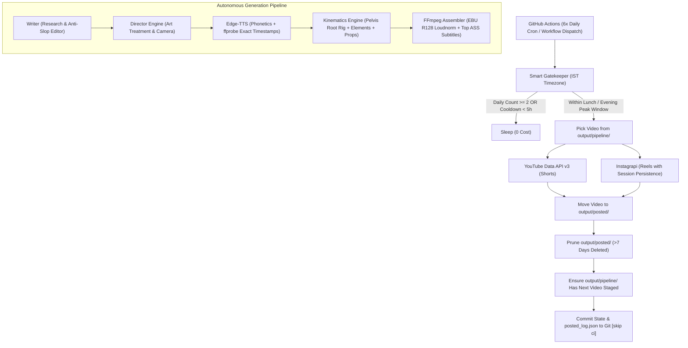

# 🚀 HyperClip AI

[](https://opensource.org/licenses/MIT)
[](https://www.python.org/)
[-success.svg)](https://github.com/Deeptanil/HyperClip-AI/actions)
[](https://youtube.com/shorts)
[](#-twitch-hype-clipper-module-gta-6--gaming)

> **Autonomous Twitch hype detector and vertical short-form clipping pipeline powered by chat velocity, paired with an AI procedural storytelling engine.**  
> Completely zero-cost, runs on free GitHub Actions cloud schedules, formats in vertical 9:16 (stacked facecam top + gameplay bottom on solid black), generates dynamic word-by-word subtitles, and auto-publishes to YouTube Shorts and Instagram Reels.

---

## 🌟 Highlights

- **Anti-Slop Multi-Stage Writing**: Cold hooks, natural narrative pacing, and concrete details. Auto-rejects AI cliché words (*"delve"*, *"testament"*, *"beacon"*, *"little did they know"*, *"in conclusion"*).
- **Procedural 2D Vector Animation Engine**:
  - **Hierarchical Continuous Kinematics**: 10-DOF skeletal joint rotation rooted at the pelvis. Zero broken bodies, floating spines, or disconnected limbs.
  - **Dynamic Vehicles & Architecture**: 1904 vintage touring cars, steam trains, skyscrapers, Parisian windows, stadium gates, finish banners.
  - **Living Nature**: Fluffy apple trees with fallen fruit, pine forests, mountains, animated rolling grass hills, excavated ditches, and weather clouds.
  - **Expressive Props & Bubbles**: Directional speech and thought bubbles with mouth-pointing vectors; props (Mjolnir, crowns, apples, briefcases, cash bags, medals).
- **Director Art Treatment**: Multi-style production modes (`historical_cartoon`, `modern_pop`, `classic_bw`).
- **Synchronized Audio & Subtitles**:
  - **Zero-Drift Karaoke**: Timestamps measured directly from audio files via `ffprobe`, eliminating cumulative caption drift.
  - **Phonetic Pronunciation Dictionary**: Automatically translates tricky proper names (*Mjolnir* $\rightarrow$ *Myol-neer*, *Thrym* $\rightarrow$ *Thrim*, *Jotunheim* $\rightarrow$ *Yoh-tun-hime*, *Carvajal* $\rightarrow$ *Car-vah-hahl*) so Edge-TTS pronounces them clearly while subtitles keep the proper spelling.
  - **EBU R128 Loudness Normalization**: Prevents audio volume creep over time using professional broadcast loudness filters (`loudnorm`).
  - **Top Safe-Zone Subtitles**: Bold Impact karaoke text placed in the upper third (`MarginV=320`) so it never blocks grounded characters, props, or platform UI elements.
- **Smart Staging Pipeline & 7-Day Rolling Archive**:
  - `output/pipeline/`: Always maintains the next post staged and ready (`YYYY-MM-DD-title.mp4`).
  - `output/posted/`: Archives published videos for 7 days; older files are automatically pruned to keep the repository lean.
- **Intelligent Gatekeeper (Optimized for Indian Audience - IST)**:
  - Runs **6 times daily** on GitHub Actions to ensure failover redundancy without ever missing a posting slot.
  - Strictly limits publishing to **2 videos per IST calendar day**.
  - Enforces a minimum **5.0-hour cooldown** between posts.
  - Aligns with Indian peak viewing windows:
    - **Midday Lunch Window**: 12:30 PM – 3:30 PM IST (07:00 – 10:00 UTC)
    - **Evening Prime Time**: 7:30 PM – 10:30 PM IST (14:00 – 17:00 UTC)

---

## ⚡ Architecture Flow



---

## 📁 Project Structure

```text
auto-clipping/
├── .github/workflows/
│   └── daily_auto_post.yml      # 6x daily scheduled runner + manual dispatch
├── output/
│   ├── pipeline/                # Next staged videos ready to publish (tracked)
│   └── posted/                  # Last 7 days archive of published videos (auto-pruned)
├── src/
│   ├── animation/
│   │   ├── character_rig.py     # Continuous skeletal kinematics (pelvis root, capsule lines)
│   │   ├── kinematics.py        # 10-DOF joint angle presets & smoothstep interpolation
│   │   ├── bubbles.py           # Speech and thought bubbles with mouth-pointing vectors
│   │   ├── elements.py          # Procedural vehicles, architecture, nature & trees
│   │   ├── environments.py      # 9:16 vertical environments (palace, dust_road, orchard, etc.)
│   │   ├── props.py             # Vector prop library (hammer, crown, apple, cash bag)
│   │   └── compositor.py        # Multi-character compositor with camera zooms & shake
│   ├── director/
│   │   └── director_engine.py   # Director treatment & production style presets
│   ├── narration/
│   │   └── tts_engine.py        # Edge-TTS speech, phonetics dictionary & upper-third ASS karaoke
│   ├── renderer/
│   │   └── engine.py            # FFmpeg assembler with EBU R128 loudness normalization
│   ├── story_engine/
│   │   ├── editor.py            # Anti-slop adversarial criticism evaluator
│   │   ├── writer.py            # Multi-stage beat planner & writer
│   │   └── vault.py             # Verified story vault (Marathon, Thor's Wedding, Eiffel Scam)
│   └── uploaders/
│       ├── youtube_uploader.py  # YouTube Data API v3 client with auto-refresh OAuth
│       ├── instagram_uploader.py# Direct Reels uploader with session reuse & checkpoint handling
│       └── tiktok_uploader.py   # Playwright cookie-based publisher
├── auto_poster.py               # Main CLI scheduler and intelligent gatekeeper
├── generate_story.py            # Standalone story generation entry point
├── posted_log.json              # Persistent audit log of all published videos
└── requirements.txt             # Python dependencies
```

---

## 🛠️ Quickstart (Local Usage)

### 1. Prerequisites
- Python 3.11+
- FFmpeg installed and available in your `PATH`

### 2. Installation
```bash
git clone https://github.com/Deeptanil/auto-clipping.git
cd auto-clipping
pip install -r requirements.txt
```

### 3. Generate a Video Locally
Generate a video without publishing:
```bash
# Generate a mythology story in modern_pop director style
python generate_story.py --category mythology --style modern_pop --output output/thor_story.mp4

# Generate a historical story in historical_cartoon style
python generate_story.py --category history --style historical_cartoon --output output/marathon.mp4
```

### 4. Run the Intelligent Scheduler Locally
```bash
# Respects IST daily quota and peak window cooldowns
python auto_poster.py

# Force upload immediately (bypassing time windows for testing)
python auto_poster.py --force
```

---

## 🎮 Twitch Hype Clipper Module (GTA 6 & Gaming)

HyperClip AI includes a dedicated module for gaming streams (GTA 6, esports, IRL):
- **Chat Velocity Spike Detection**: Downloads chat JSON via `TwitchDownloaderCLI` and calculates sliding-window message velocity and emote hype density (`OMEGALUL`, `KEKW`, `POG`, `W`, `CLIP IT`, `NO WAY`).
- **Precision Sub-Minute Clip Slicing**: Downloads only the 30–50s highlight window directly from Twitch VODs using `-b` and `-e` arguments to save bandwidth and runner compute time.
- **Stacked 9:16 Portrait Canvas (Black Background)**:
  - **With Facecam**: Stacked layout with cropped facecam at the top and gameplay at the bottom over a clean, solid black canvas (`#000000` — zero distracting blur).
  - **No Facecam**: Full 16:9 gameplay centered on the vertical black canvas with clean letterboxing.
- **Word-by-Word ASS Karaoke Captions**: Free local streamer speech transcription using `faster-whisper` burned in the upper safe viewing zone.
- **Second Channel / Account Multi-Posting**: Posts gaming clips to a dedicated secondary Instagram account (`INSTA_USERNAME_2`) and YouTube Shorts.

---

## ☁️ Running 100% Free on GitHub Actions

The platform runs autonomously in the cloud on GitHub Actions runners without requiring a paid VPS or server.

### 1. Configure GitHub Repository Secrets
Go to your GitHub repository: **Settings → Secrets and variables → Actions → New repository secret**:

| Secret Name | Description |
| :--- | :--- |
| `YOUTUBE_CLIENT_ID` | Google Cloud Console OAuth Client ID |
| `YOUTUBE_CLIENT_SECRET` | Google Cloud Console OAuth Client Secret |
| `YOUTUBE_REFRESH_TOKEN` | YouTube OAuth2 Refresh Token (generated via `tools/get_youtube_token.py`) |
| `INSTA_USERNAME` | Instagram Username |
| `INSTA_PASSWORD` | Instagram Password |
| `INSTA_SESSION_DATA` | Saved `ig_session.json` string to bypass security checkpoints |
| `GEMINI_API_KEY` | *(Optional)* Google Gemini API key for dynamic story generation |

### 2. Schedule Timing (IST Optimized)
The workflow (`.github/workflows/daily_auto_post.yml`) evaluates 6 times a day:
- `cron: '0 3,7,10,14,16,19 * * *'`
- **Indian Lunch Slot**: 12:30 PM IST (with backup at 3:30 PM IST)
- **Indian Evening Slot**: 7:30 PM IST (with backup at 9:30 PM IST)

---

## 💡 Acknowledgements & Credits

This project stands on the shoulders of several outstanding open-source projects, architectures, and creators:

- **[lay295/TwitchDownloader](https://github.com/lay295/TwitchDownloader)**: The foundational CLI and engine for high-speed Twitch chat JSON extraction and sub-minute VOD segment downloading.
- **[rahulanand1103/youtube-script-writer](https://github.com/rahulanand1103/youtube-script-writer)**: Inspiration for the multi-agent scriptwriting system, beat-sheet planning, tone controls, and adversarial editorial gatekeeper rules.
- **[kaomei/stickman-video-director](https://github.com/kaomei/stickman-video-director)**: Concept for the Stickman Director architecture, Director vs. Autopilot modes, production locks, and multi-style art direction presets (`modern_pop`, `historical_cartoon`, `classic_bw`).
- **[Yash-Kavaiya/manim-video-generator-actor](https://github.com/Yash-Kavaiya/manim-video-generator-actor)**: Architectural model for actor rigs, dynamic gestures, and vector speech/thought bubbles that direct their tails precisely to the speaker's mouth.
- **[gestura-ai/stick-gen](https://github.com/gestura-ai/stick-gen)**: Inspiration for the 10-DOF skeletal rotational kinematics, Hermite smoothstep easing curves, and continuous athletic running stride.
- **[Abhinavkumar-07/youtube-instagram-auto-uploader](https://github.com/Abhinavkumar-07/youtube-instagram-auto-uploader)**: Cloud automation architecture for scheduled multi-platform publishing via GitHub Actions.
- **[hexgrad/kokoro](https://github.com/hexgrad/kokoro)** & **[Microsoft Edge-TTS](https://github.com/rany2/edge-tts)**: High-naturalness zero-cost voice synthesis technology powering the narration.
- **FFmpeg & Gyan.dev**: Industrial-strength multimedia processing, subtitle burning, and EBU R128 loudness normalization.

---

## 📄 License

This project is licensed under the [MIT License](LICENSE).
