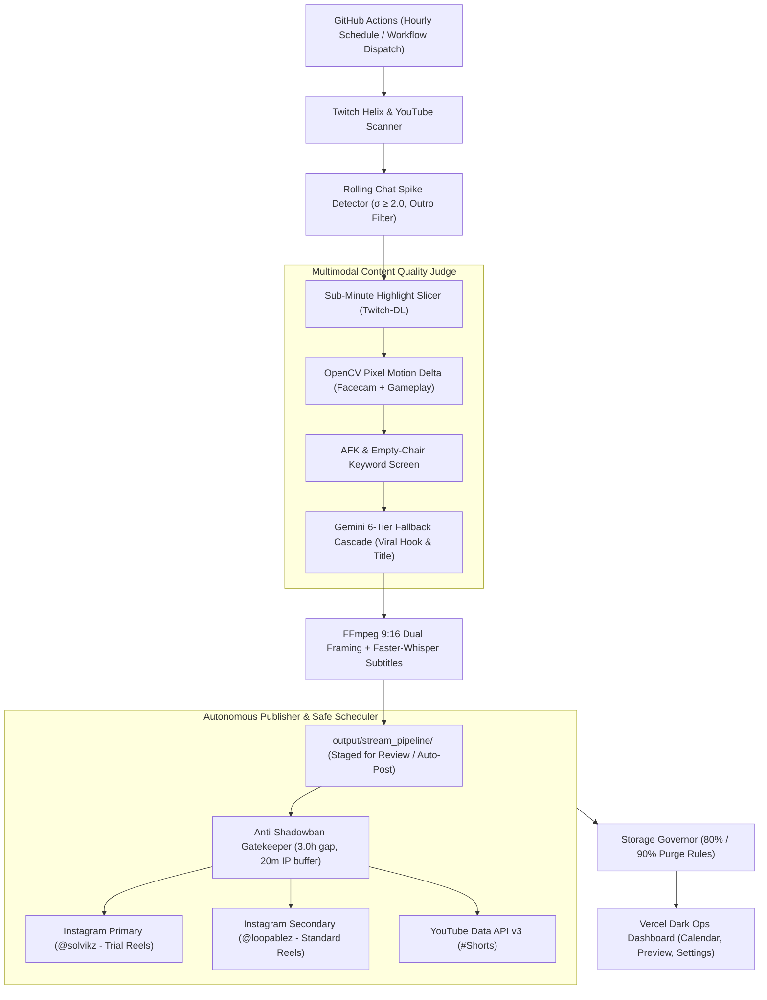

# ⚡ HyperClip AI // Autonomous Gaming & Stream Clipper

[](https://opensource.org/licenses/MIT)
[](https://www.python.org/)
[-success.svg)](https://github.com/Deeptanil/HyperClip-AI/actions)
[](https://vercel.com/new/clone?repository-url=https%3A%2F%2Fgithub.com%2FDeeptanil%2FHyperClip-AI)
[](https://youtube.com/shorts)
[](#-anti-shadowban--rate-limit-shield)

> **Autonomous multi-stream hype detector, AI content judge, vertical 9:16 framing assembler, and multi-account auto-publisher for YouTube Shorts and Instagram Reels.**  
> Includes a sleek, pitch-black minimalist **Control Dashboard** deployable to Vercel with a single click.

---

## 🌟 Key Capabilities

- **Autonomous Live & VOD Stream Monitoring**:
  Continuously monitors elite gaming & IRL creators (**IShowSpeed, Kai Cenat, xQc, Clix, CaseOh, Jynxzi, DarkViperAU**) via the official Twitch Helix API and YouTube live chat.
- **Statistical Chat Hype Spike Detection**:
  Extracts rolling chat velocity ($z$-score $\sigma \ge 2.0$) and emote density (`W`, `L`, `POG`, `CLIP IT`, `NO WAY`, `OMEGALUL`). Automatically skips stream intro sequences and outro/goodbye spam.
- **Multimodal AI Content Quality & Viral Judge**:
  - **OpenCV Pixel-Delta Motion Check**: Analyzes frame-by-frame visual activity across gameplay and facecam regions to prevent clipping dead lobbies or frozen screens.
  - **AFK Keyword Screening**: Eliminates empty-chair clips (bathroom breaks, paused streams).
  - **Gemini Structured Viral Evaluation**: Scores humor, shock value, and competitive gameplay, generating bespoke viral titles, hooks, and hashtags (no generic boilerplate).
- **Dual-Stack 9:16 Portrait Assembler**:
  - Auto-tracks streamer facecams and frames them directly above 16:9 gameplay over a solid black `#000000` canvas.
  - Generates zero-drift word-by-word dynamic karaoke subtitles via **Faster-Whisper**.
- **Multi-Clip Stream Yield**:
  Extracts 2–3 highlights (spaced $\ge 300\text{s}$) per downloaded chat to maximize Action runner efficiency without redundant downloads.
- **Automated Storage Governor**:
  - Automatically cleans cache and purges posted clips when storage reaches 80% (1,200 MB) or 90% (1,350 MB).
  - **Critical Safeguard**: Clips waiting in `stream_pipeline/` are **never deleted**.
- **Vercel Control Dashboard**:
  - Pitch-black (`#000000`) and electric yellow (`#FACC15`) minimalist dark mode.
  - 24-Hour Google Calendar-style week grid (00:00 to 23:00) with day and month views.
  - 9:16 portrait playable video preview modal with 1-click **Approve** and **Decline** actions.
  - Built-in shadowban hazard warning alerts if posting intervals drop below safe limits.

---

## 🛡️ Anti-Shadowban & Rate-Limit Shield

Instagram and YouTube have strict automated botnet and spam filters. HyperClip AI implements hardcoded, unbypassable safety constraints:

| Safety Rule | Setting | Purpose |
| :--- | :--- | :--- |
| **Per-Account Minimum Gap** | **$\ge 3.0$ Hours** | Prevents single-account spam detection and account throttling. |
| **Cross-Account IP Buffer** | **$\ge 20$ Minutes** | Never uploads to two Instagram accounts simultaneously from the same runner IP. |
| **Missed Upload Prioritization** | **Staggered Catch-Up** | Rotates to accounts with missed uploads first without rapid-fire posting. |
| **Hard Daily Ceilings** | **$\le 3\text{--}4$ Posts / Day** | Hard caps total daily volume per account regardless of manual triggers. |
| **YouTube Daily Quota** | **1,600 / 10,000 units** | Conserves Google Cloud API quota safely within the free tier. |

---

## ⚡ Architecture Flow



---

## 📁 Repository Structure

```text
HyperClip-AI/
├── .github/workflows/
│   ├── twitch_clipper.yml       # Cloud autonomous clipping & publishing runner
│   └── daily_auto_post.yml      # Procedural video generator schedule
├── dashboard/                   # Minimalist Dark/Yellow Vercel Web Dashboard
│   ├── index.html               # Single-page command center & calendar
│   ├── styles.css               # Pitch black (#000000) & yellow (#FACC15) theme
│   └── app.js                   # GitHub REST API client & spacing calculator
├── output/
│   ├── stream_pipeline/         # High-priority clips staged for publication
│   └── stream_posted/           # Archive of published MP4s and metadata
├── src/
│   ├── twitch_clipper/
│   │   ├── hype_detector.py     # Statistical rolling z-score spike analyzer
│   │   ├── content_judge.py     # Multimodal OpenCV motion + Gemini viral filter
│   │   ├── facecam_detector.py  # Computer vision facecam localization
│   │   └── subtitle_engine.py   # Faster-Whisper word-by-word karaoke generator
│   └── uploaders/
│       ├── instagram_uploader.py# Direct Instagram uploader with trial reel fallback
│       └── youtube_uploader.py  # YouTube Data API v3 client with auto-refresh
├── config.json                  # Streamer targets, thresholds & posting schedule
├── twitch_clipper.py            # Primary CLI orchestrator & storage governor
├── vercel.json                  # Zero-configuration Vercel deployment specification
└── requirements.txt             # Core Python dependencies
```

---

## 🚀 Quick Start Guide

### 1. Prerequisites
- Python 3.11+
- FFmpeg installed and accessible in your system `PATH`
- Git

### 2. Fork & Clone
```bash
git clone https://github.com/Deeptanil/HyperClip-AI.git
cd HyperClip-AI
pip install -r requirements.txt
```

### 3. Configure GitHub Secrets (For Autonomous Cloud Runs)
If running autonomously via GitHub Actions, add these in **Settings → Secrets and variables → Actions**:

| Secret Name | Required For | Description |
| :--- | :--- | :--- |
| `GEMINI_API_KEY` | **AI Judge** | Google Gemini API key (Free at [aistudio.google.com](https://aistudio.google.com/)) |
| `TWITCH_CLIENT_ID` | **Twitch Scanner** | Twitch Developer Console Client ID |
| `TWITCH_CLIENT_SECRET`| **Twitch Scanner** | Twitch Developer Console Client Secret |
| `INSTA_USERNAME` | **Instagram 1** | Primary Instagram account username |
| `INSTA_PASSWORD` | **Instagram 1** | Primary Instagram account password |
| `INSTA_SESSION_DATA` | **Instagram 1** | Exported JSON session string to bypass checkpoints |
| `INSTA_USERNAME_2` | **Instagram 2** | Secondary Instagram account username |
| `INSTA_PASSWORD_2` | **Instagram 2** | Secondary Instagram account password |
| `INSTA_SESSION_DATA_2`| **Instagram 2** | Exported session string for account 2 |
| `YOUTUBE_CLIENT_ID` | **YouTube Shorts**| Google Cloud Console OAuth Client ID |
| `YOUTUBE_CLIENT_SECRET`|**YouTube Shorts**| Google Cloud Console OAuth Client Secret |
| `YOUTUBE_REFRESH_TOKEN`|**YouTube Shorts**| OAuth2 Refresh Token (generated via `tools/get_youtube_token.py`) |

---

## 🌐 Deploy the Dashboard to Vercel (1-Click)

The dashboard is completely decoupled and runs 100% free on Vercel:

1. Click the **Deploy with Vercel** button above or import your forked repository in [vercel.com](https://vercel.com).
2. Framework Preset: Select **Other** (Vercel automatically detects `vercel.json` and serves `dashboard/`).
3. Click **Deploy**.
4. Open your live dashboard URL:
   - Click **🔑 Setup** in the top navigation.
   - Enter your GitHub Personal Access Token (PAT) with `repo` and `workflow` scopes.
   - Your token stays securely inside your browser's `localStorage` — zero external databases.

*(To test the dashboard locally)*:
```bash
python -m http.server 3000 --directory dashboard
# Open http://localhost:3000 in your browser
```

---

## ⚙️ Configuration Reference (`config.json`)

Edit `config.json` to customize streamers, sensitivities, and posting limits:

```json
{
  "twitch_clipper": {
    "enabled": true,
    "max_clips_per_vod": 3,
    "min_clip_spacing_sec": 300,
    "min_spike_sigma": 2.0,
    "intro_skip_sec": 480,
    "outro_skip_sec": 360,
    "layout": "auto_stacked"
  },
  "storage_governor": {
    "enabled": true,
    "max_repo_mb": 1500,
    "cleanup_threshold_percent": 80,
    "aggressive_threshold_percent": 90,
    "max_posted_archive_days": 5
  },
  "publishing_schedule": {
    "min_cross_account_gap_minutes": 20,
    "youtube": {
      "enabled": true,
      "shorts_per_day": 3,
      "min_gap_hours": 3.0,
      "hard_daily_ceiling": 3
    },
    "instagram_accounts": [
      {
        "name": "Primary Account",
        "slot": 1,
        "regular_per_day": 2,
        "trial_per_day": 1,
        "min_gap_hours": 3.0,
        "hard_daily_ceiling": 3
      },
      {
        "name": "Secondary Account",
        "slot": 2,
        "regular_per_day": 3,
        "trial_per_day": 0,
        "min_gap_hours": 3.0,
        "hard_daily_ceiling": 3
      }
    ]
  }
}
```

---

## 💻 CLI Usage (Local Execution)

```bash
# 1. Check live and recent VOD targets without downloading:
python twitch_clipper.py --check-only

# 2. Harvest fresh hype clips into output/stream_pipeline/ (no publishing):
python twitch_clipper.py --harvest-only

# 3. Publish next eligible staged clip (respects cooldowns and daily ceilings):
python twitch_clipper.py

# 4. Target a specific platform or account slot:
python twitch_clipper.py --platforms instagram --ig-slot 2

# 5. Run procedural story generator (alternative mode):
python generate_story.py --category history --style modern_pop
```

---

## ⚠️ Important Account Safety Notice

> [!WARNING]
> Setting post frequency higher than 3–4 reels per day on a single account or reducing the cooldown below 3.0 hours triggers Instagram's automated spam detection. This will result in account shadowbans, revoking of trial reel privileges, or temporary API blocks. Maintain at least 3.0 hours between posts on the same account.

---

## 📄 License

This project is licensed under the [MIT License](LICENSE).
